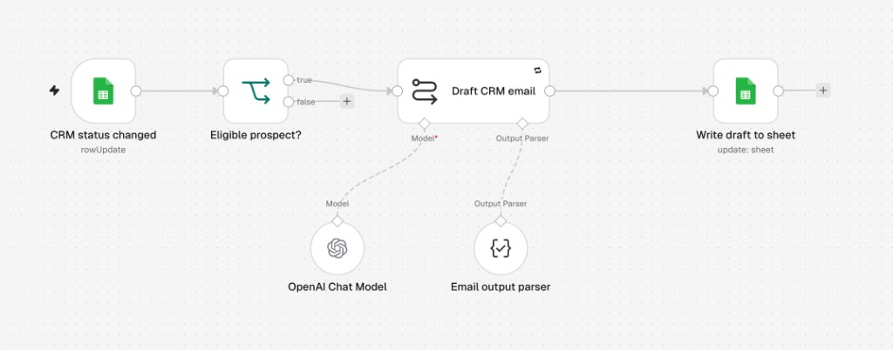

# Relances CRM — brouillons d'e-mails

Automatisation n8n pour le CRM de WebSite Studio. Quand le statut d'un prospect change dans le Google Sheet, le workflow rédige un e-mail de suivi et le réécrit dans la même ligne. Le mail n'est pas envoyé : il reste un brouillon à copier dans la messagerie.

Le workflow publié s'appelle **messaging with status**. Il suit une vingtaine de prospects (conciergeries, sites et automatisations).

## Canvas



## Déroulé

1. **CRM status changed** surveille l'onglet `CRM`. C'est un déclencheur Google Sheets en `rowUpdate`, qui ne réagit qu'à la colonne `état`, environ une fois par minute.
2. **Eligible prospect?** ne laisse passer une ligne que si `mail`, `note` et `état` sont remplis, et si `état` n'est pas `Issue ?`. Les autres lignes s'arrêtent sur la branche `false`.
3. **Draft CRM email** rédige l'objet et le corps. Le modèle du canvas est **OpenAI Chat Model**. **Email output parser** impose un JSON `{ "subject", "body" }` et renvoie le texte au modèle s'il ne respecte pas ce format.
4. **Write draft to sheet** met à jour la ligne dont le `mail` correspond. Il écrit `Objet mail` et `Brouillon mail`.

Le modèle reçoit le prospect, l'e-mail, le nom, le téléphone, le statut et la note. Il s'appuie sur la note pour l'accroche et n'invente pas de faits absents. Le ton est en vouvoiement, chaleureux, d'environ 120 à 220 mots, sans prix ni offre sauf si la note le demande. La signature est `Bien à vous,` puis `Félix Machenaud`.

Les statuts utilisés dans le CRM sont par exemple `Demande de mail`, `Lead show`, et les points de contact successifs. Changer `état` et la `note`, puis attendre le cycle du déclencheur, produit un nouveau brouillon.

## Vidéo

La présentation filmée est dans [`n8n/presentation-n8n.mp4`](n8n/presentation-n8n.mp4) (environ 10 minutes). La transcription est dans [`n8n/transcription.txt`](n8n/transcription.txt).

## Dépôt

| Chemin | Rôle |
| --- | --- |
| `.cursor/n8n-crm-draft-workflow.ts` | Source du workflow, écrite avec le SDK n8n (`workflow`, `trigger`, `node`). |
| `workflows/messaging-with-status.json` | Export du workflow de relance. |
| `workflows/my-workflow.json`, `my-workflow-2.json`, `my-workflow-3-archived.json` | Essais précédents, dont une version archivée. |
| `docs/workflow-canvas.png` | Capture du canvas ci-dessus. |
| `n8n/presentation-n8n.mp4` | Vidéo de présentation, compressée pour GitHub. |
| `n8n/transcription.txt` | Transcription de la vidéo. |
| `skills/` | Références n8n utilisées pour concevoir le workflow. |

Le fichier `.workflow.ts` décrit les nœuds et leurs connexions en TypeScript. Ce n'est pas l'exécution : le workflow qui tourne est celui de l'instance n8n. L'export JSON du dépôt cite encore les modèles Gemini utilisés avant le basculement vers OpenAI, visible sur le canvas.

## Commandes

`n8n-cli` interroge l'instance déjà configurée dans `~/.n8n-cli/config.json`. La clé API ne figure pas dans ce dépôt.

```bash
n8n-cli workflow list
n8n-cli workflow list --active
n8n-cli execution list
```

`workflow list` affiche les workflows et s'ils sont actifs. `execution list` affiche les dernières exécutions, avec leur statut (`success` ou `error`) et leur date.

## Mise en route

Il faut une instance n8n, un accès Google Sheets (OAuth) sur le classeur CRM, et un identifiant OpenAI. Les secrets restent dans les credentials n8n. Pour relancer une démo : modifier `état` et `note` sur une ligne qui a déjà un `mail`, attendre le passage du déclencheur, puis lire `Objet mail` et `Brouillon mail` sur cette ligne.

## Limite connue

Le déclencheur peut conduire le modèle à réécrire des brouillons au-delà de la seule ligne qui vient de changer. Le comportement voulu est de ne rédiger que le prospect dont le statut vient d'être modifié.
